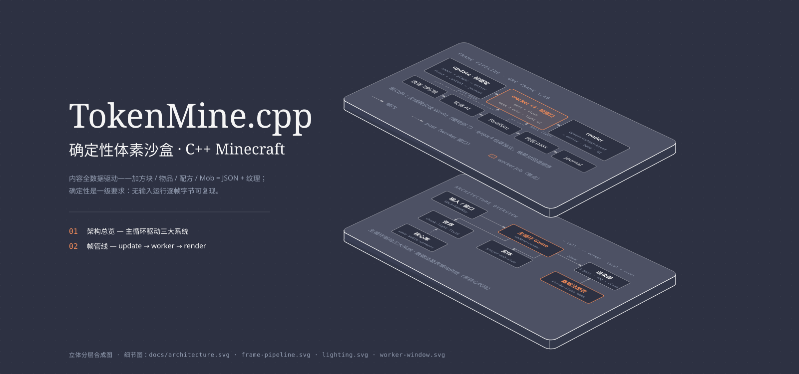

<div align="center">

<h1>
  
</h1>

**本地 LLM 编写的 C++ 版 Minecraft：可运行、可扩展的 3D 体素沙盒<br>
（C++20 / SDL3 / OpenGL 3.3，自研 JSON/PNG，内容全数据驱动）。<br>
确定性是一级要求——无输入运行逐帧字节可复现。<br>
v3.3.0 已发布（**手柄支持**：Xbox 布局左/右摇杆 + 9 键映射，键鼠手柄可同用；tag `v3.3.0`；前版 v3.2.0 = 下界传送门框【4×5 框点火激活，下界世界随 v3.4.0】/ v3.1.0 = 存档 gzip 压缩【默认开，旧档零迁移，门档 6.3×】）· 3.x「世界扩展」期进行中，下一版 v3.4.0 = V3-1 Phase B 下界世界 + 真传送（任务表见 [docs/BACKLOG.md](docs/BACKLOG.md)）**

[](https://github.com/shmilee/TokenMine.cpp/stargazers)
[](LICENSE)

**[项目名](#项目名) · [技术栈](#技术栈) · [构建与运行](#构建与运行) · [版本与发布](#版本与发布) · [文档地图](#文档地图) · [开发约定](#开发约定)**

</div>

## 项目名

**TokenMine.cpp** —— 一语三关：

- **Token**：这座矿是 token 一行行"挖"出来的——整个项目由本地 LLM 编写；
- **Mine**：Minecraft 的"挖矿"，也是英语的 "my"（这座矿是我的）；
- **.cpp**：程序员圈的命名梗，"X.cpp" 即 "X 的 C++ 重写版"。
- **起源与实现**：P0 之前的《开发总提示词》由 ChatGPT 起草（1164 行原始文本
  未做任何改动，见 [initial-chatgpt-prompt.md](initial-chatgpt-prompt.md)）；
  但自 P0 起，每一步——设计、实现、测试、文档——全部由本地 LLM
  **Qwen3.8 27B** 完成。ChatGPT 只参与了"画图纸"，挖矿的全程是本地 LLM 干完的。

## 技术栈

| 领域 | 选择 | 说明 |
|---|---|---|
| 语言 | C++20 | |
| 构建 | CMake + Ninja | |
| 窗口/输入 | SDL3 | |
| 图形 | OpenGL 3.3 Core (GLEW) | |
| 音频 | SDL3 Audio（`SoundBank`，SDL 内置音频后端） | Phase 15 引入，38 个程序化 WAV（确定性生成，含 CRAFT-3 材质音效 + PRE-4 环境音） |
| 图像 | 内置 PNG 编解码器（`src/core/png.hpp`，zlib） | 8/16 位 RGB/RGBA/灰度/调色板，全 filter，CRC 校验 |
| 测试 | GoogleTest | |
| JSON | 内置实现（`src/core/json.hpp`） | 无外部依赖 |

## 构建与运行

```bash
cmake -B build -G Ninja -DCMAKE_BUILD_TYPE=Release
cmake --build build

# 运行（打开窗口，ESC 或关闭窗口退出）
./build/bin/tokenmine

# 运行 120 帧后自动退出（可用于自动化验证）
./build/bin/tokenmine --frames 120

# 运行 300 帧并保存最后一帧截图
./build/bin/tokenmine --frames 300 --screenshot shot.png

# 其他参数
./build/bin/tokenmine --config config/config.json --seed 42 --log-level debug

# 从指定时刻开始（0 = 黎明前, 0.25 = 正午, 0.5 = 日落, 0.75 = 午夜）
./build/bin/tokenmine --time 0.75

# 存档槽（Phase 13）：启动时加载 data/saves/<slot>.json（若存在），干净退出时写回
./build/bin/tokenmine --save myworld
# 忽略现有存档、从全新世界开始（退出时覆盖该槽）
./build/bin/tokenmine --save myworld --new
```

**窗口**：大小由 `config/config.json` 的 `window.width`/`window.height` 决定（默认
1280×720）。窗口模式下窗口可被用户缩放（`window.resizable`，默认 `true`）——
视口、投影纵横比与屏幕 UI 布局每帧读取窗口当前像素尺寸，缩放后场景立即跟随
（最小尺寸 320×200）；设为 `false` 则锁定在配置尺寸。

**内存提示**：默认 `config/config.json` 为 `view_distance: 80`（圆盘环
满环 ~103k chunk ≈ 4.6 GB，会随探索持续加载）。内存 <8 GB 的机器建议
改为 16–32（`world.view_distance`，16 ≈ 2 GB 量级）。

## 构建依赖

**平台**：Linux 验证（Arch；CMake 3.25+ / Ninja）。macOS / Windows 未测试
（SDL3 与 GLEW 在对应平台的可用性未验证）。

| 依赖 | 用途 | Arch 安装 |
|---|---|---|
| CMake ≥ 3.25 + Ninja | 构建 | `sudo pacman -S cmake ninja` |
| SDL3 | 窗口/输入/音频 | `sudo pacman -S sdl3` |
| GLEW + OpenGL 3.3 | 图形（需驱动，Intel iGPU 验证） | `sudo pacman -S mesa libglvnd-glew` |
| zlib | 内置 PNG 解码 | 系统自带 |
| GTest | 单元测试 | `sudo pacman -S googletest` |

其他发行版：装齐上表五项即可（`find_package`/`pkg_check_modules` 自动发现）。

## 版本与发布

- **v0.1.0**（首个公开版）：可玩的 3D 体素沙盒——世界生成与流送、昼夜
  光照、流体、Mob 与战斗、合成、存档
- **v1.0.0**（首个正式版）：十大系统完成，生存玩法闭环；其后 1.x 系列
  深化生存：火系统（蔓延 / 火把 / 燧石与钢）、工具分类（镐 / 斧 / 铲）、
  护甲与耐久修复、药水与状态效果、死亡统计、炉子燃料熔炼、背包操作、
  第三人称相机与玩家模型、中文字体与 11 步教程、云方块化、洞穴矿脉
  演进
- **v2.0.0**：1.x 收官；其后 2.x「上手与体验补全」系列再添：经验与 7 种
  附魔、15 色染色床（睡觉跳夜）、蝙蝠（首只飞行 mob）与染色羊、雪原
  群系、顶部 / 双 slab、环境光遮蔽（smooth lighting）、天气（雨 / 雷）、
  新手教程系列、Steve 皮肤、滚轮缩放 / 双击 Space 飞行 / 24 小时时钟
- **v3.0.0**（当前）：3.x「世界扩展」开启——存档 gzip 压缩（v3.1.0，
  默认开，旧档直读零迁移，门档实测 6.3×）+ 下界传送门（v3.2.0：4×5 框
  点火激活/去激活/站入，下界世界随 v3.4.0 到）+ 手柄支持（v3.3.0：
  Xbox 布局，键鼠手柄同用）；netherite 材料链与 demo 回放在列

逐版明细与发布历史：[`docs/CHANGELOG.md`](docs/CHANGELOG.md)（当前时
代）+ `docs/archive/*/CHANGELOG.md`（历史时代）+ GitHub Releases。

> 存档与内容数据格式仍可能随阶段演进（存档向前迁移兼容）——旧存档通常
> 可读，但请定期备份。已知限制见 `docs/KNOWN_ISSUES.md`。

## 文档地图

文档已按主题分块：**新会话先读 [AGENTS.md](AGENTS.md)**，再按需读下表中的文件。历史细节全部在 `docs/archive/`。

| 文档 | 内容 | 何时读 |
|---|---|---|
| [AGENTS.md](AGENTS.md) | 代理快速接收：现状/命令/硬性规则/E2E 协议/阶段流程/坑位速览 | 新会话第一件事 |
| [docs/GAMEPLAY.md](docs/GAMEPLAY.md) | 玩法指南（操作/生存循环/战斗与食物/工具路线/昼夜） | 玩法问题 |
| [docs/MECHANICS.md](docs/MECHANICS.md) | 机制详解（现状 v2.19.0，16 子系统分节；2026-11-04 收官刷新） | 改玩法逻辑前 |
| [docs/CONTENT_GUIDE.md](docs/CONTENT_GUIDE.md) | 数据驱动内容添加（biome/方块/配方/Mob/hotbar）+ 存档使用 + worldgen 参数 | 加内容/调世界 |
| [docs/ARCHITECTURE.md](docs/ARCHITECTURE.md) | 目录结构 + 核心架构（模块/线程池/存档格式/帧管线） | 改架构前 |
| [docs/PROTOCOL.md](docs/PROTOCOL.md) | 开发协议：命令/技术栈/硬性约定/测试/**E2E 协议** | 写代码与验证前 |
| [docs/PITS.md](docs/PITS.md) | 坑位合集（386 条，都踩过） | 遇到怪问题 |
| [docs/KNOWN_ISSUES.md](docs/KNOWN_ISSUES.md) | 已知问题清单（活跃；pre-2.0 已修复索引 → `docs/archive/PRE2.0-FIXED-INDEX.md`） | 阶段验收前后 |
| [docs/archive/v0x/ROADMAP.md](docs/archive/v0x/ROADMAP.md) | 0.x 时代 Phase 0–29 规划（已归档） | 了解历史 |
| [docs/CHANGELOG.md](docs/CHANGELOG.md) | 版本历史（3.x 时代逐版明细，v3.0.0 起；v2.x 全两批 → `docs/archive/v2x/CHANGELOG.md`、v1.x → `docs/archive/v1x/CHANGELOG.md`、v0.x → `docs/archive/v0x/CHANGELOG.md`） | 查某版改了什么 |
| [docs/BACKLOG.md](docs/BACKLOG.md) | **3.x「世界扩展」任务表（执行权威）**（11-04 二批收官晋升 + 同日重编号【原 4.x 命名改 3.x】：V3-7 存档 gzip 先执 = v3.1.0，其后 V3-1 下界维度锚；2.x 全任务表 → `docs/archive/v2x/BACKLOG.md`） | 取下一个任务 |
| [docs/archive/](docs/archive/) | 阶段细节存档（v2x/：20 phase 全两批 + HISTORY.md 全史 + v2x/CHANGELOG.md + v2x/BACKLOG.md；1.x：181 phase + HISTORY.md 全史） | 深挖某阶段 |
| [docs/archive/v0x/](docs/archive/v0x/) | 0.x 时代文档（ROADMAP 规划 / DISCUSSION 记录 / v0x/CHANGELOG.md） | 深挖 0.x |
| `opencode-sessions/SESSION_CONTEXT.md`（本地，不入库） | 会话交接：最新状态/提交列表/下一步（历史块/遗留附录 → 同目录 `archive/`；新会话启动 prompt 同目录） | 任何"继续"会话 |

## 开发约定

- 游戏逻辑不直接调用 GL/SDL API —— 图形走 Renderer（Phase 1），窗口走 `Window`。
- 数据驱动：方块/物品/配方通过注册表（Registry）管理，新增内容 = 资源 + 数据，不改核心代码。
- 世界坐标 / Chunk 坐标 / Local 坐标严格区分，转换函数集中定义。
- 错误必须显式传播（`Result<T>` + `MC_TRY`），不允许静默失败。
- 每个阶段完成后：编译 → 运行 → 测试 → 修复 → 总结，再进入下一阶段。

## 许可证

MIT（见 `LICENSE`）。
